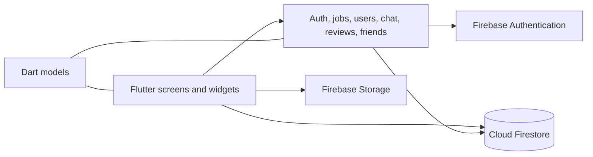

# Brotrachka

**A Flutter application for finding short-term work and connecting workers with employers.**


A student project exploring a job marketplace: employers publish listings and review applications; workers browse opportunities, apply, and communicate through in-app chat. The interface is in Russian.

[Features](#key-features) · [Architecture](#architecture) · [Setup](#getting-started) · [Validation](docs/VALIDATION.md) · [Screenshots](docs/SCREENSHOTS.md)

## Overview

The project implements a mobile client with Firebase Authentication, Cloud Firestore and Firebase Storage. It demonstrates Flutter navigation and forms, asynchronous data access, document modelling, message streams, and integration with managed backend services.

This is an educational prototype. There is no claim of production deployment, active users, or completed end-to-end validation against a live Firebase project.

## Key features

The following flows have implementations in the source. Firebase-dependent behaviour requires a configured development backend; see [validation and limitations](docs/VALIDATION.md).

- **Accounts:** email/password registration and login, worker/employer role selection.
- **Job listings:** create, edit and delete listings with payment, city, requirements and the number of people needed; search and filter listings by title, location, type and payment.
- **Applications:** apply for a job, view applications, and accept or reject applicants. Acceptance opens a conversation.
- **Messaging:** Firestore-backed conversation and message streams, unread/read state, and conversations associated with jobs.
- **Profiles:** role, city, display information, avatar upload and account settings.
- **Reviews and contacts:** submit ratings and comments, calculate an average rating, search for people and manage friend requests.

## Tech stack

| Area | Implementation |
| --- | --- |
| UI | Flutter, Dart, Material widgets, named routes |
| Authentication | Firebase Authentication, email/password |
| Data | Cloud Firestore documents, queries and snapshot streams |
| Images | Firebase Storage and `image_picker` |
| Supporting packages | `flutter_svg`, `intl`, `dropdown_search`, `logger` |
| Checks | Flutter analyzer, `flutter_test`, web compilation |

## Architecture



Screens call service classes and, in several places, Firestore directly. There is no separate application server. Access control therefore depends on Firebase rules, which are not included in this repository.

```text
lib/
├── main.dart              # Firebase initialization and application entry point
├── router.dart            # Named routes
├── models/                # Job and user data models
├── services/              # Authentication and Firestore operations
├── screens/
│   ├── auth/              # Registration, login and role selection
│   ├── jobs/              # Listings, filters, details and editing
│   ├── profile/           # Profiles, applications and contacts
│   ├── chat/              # Conversation list and messages
│   └── review/            # Reviews and rating submission
└── widgets/               # Shared UI, including job cards
assets/                    # City data and artwork
android/, ios/, web/        # Platform projects
test/                     # Job-model and job-card checks
```

Other platform directories are Flutter scaffolding; their presence does not establish desktop support. Some model/widget files are placeholders rather than completed components.

## Screenshots / demo

A public demo and verified screenshots are not available yet. The [capture checklist](docs/SCREENSHOTS.md) specifies the five screens to record from a configured development instance: registration, listings, job creation, profile and chat. No generated UI or fabricated backend results are used as project evidence.

## Getting started

### Prerequisites

- **Flutter 3.24.5 / Dart 3.5.4**, matching the committed dependency lock. The version is recorded in `.flutter-version`.
- An Android device/emulator and Android SDK for mobile development, or Chrome for the web target. iOS additionally requires macOS and Xcode.
- Your own Firebase development project for authenticated workflows. Existing client configuration refers to the original project; it does not grant permission to use its data.

```bash
git clone https://github.com/AlexandrDolmatov/Brotrachka.git
cd Brotrachka
flutter --version
flutter pub get --enforce-lockfile
```

Follow [Firebase configuration](docs/FIREBASE_SETUP.md) before running connected features.

```bash
flutter devices
flutter run -d <device-id>

# Web target; native avatar upload is a known limitation on web.
flutter run -d chrome
```

### Local checks

```bash
flutter test --no-pub
flutter analyze --no-pub
flutter build web --no-pub
```

The full analyzer currently reports 531 existing informational diagnostics (no warnings or errors in the reviewed run); it is not a clean lint baseline. CI keeps them visible and fails on analyzer warnings/errors, test failures and build failures. Tests cover local model conversion and job-card interaction, **not** Firebase authorization or complete account-to-chat workflows. Exact outcomes and scope are recorded in [VALIDATION.md](docs/VALIDATION.md).

## Configuration and limitations

- Configure Authentication, Firestore and Storage in your own Firebase project; rules and composite indexes must be reviewed separately. No backend deployment is bundled.
- The current registration flow expects `nicknames/nicks` to exist. Its nickname check and account/profile writes are not atomic.
- Application acceptance updates multiple documents separately; capacity checks are not consistently transactional.
- Profile field names are inconsistent across parts of the UI (`name`/`displayName`, `avatarUrl`/`profileImageUrl`). A fast switch to the profile tab can occur before profile data has loaded.
- Chat identifiers are based on participants, so a conversation can be reused across jobs. Deleting a chat document does not explicitly remove its message subcollection.
- Avatar upload uses `dart:io` and `putFile`; a successful web build does not establish that this flow works in a browser.
- Dependencies and native platform templates originate from the 2024 project. Native release builds and production security rules have not been verified.

These are documented follow-up tasks, not completed capabilities. See the [technical review](docs/VALIDATION.md) for details.

## Author

**Aleksandr Dolmatov** · [GitHub](https://github.com/AlexandrDolmatov) · [LinkedIn](https://www.linkedin.com/in/aleksandr-dolmatov-suai/)

Personal educational project. No commercial usage or production-readiness claims are made.
